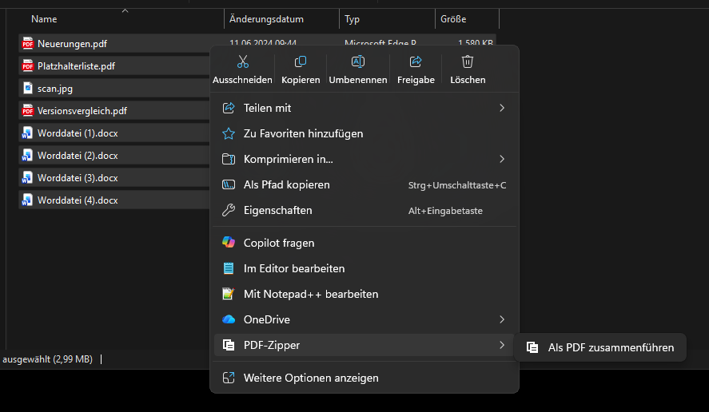
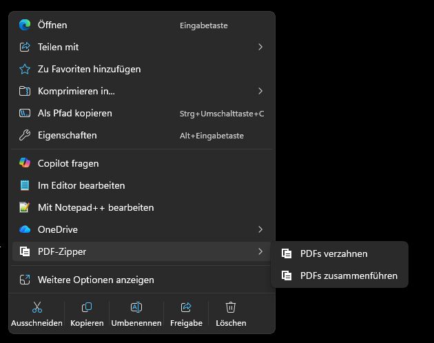
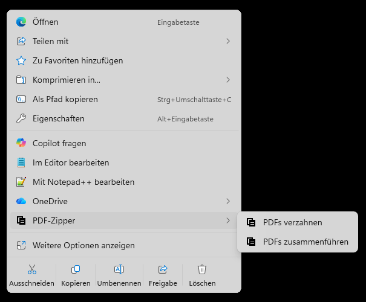
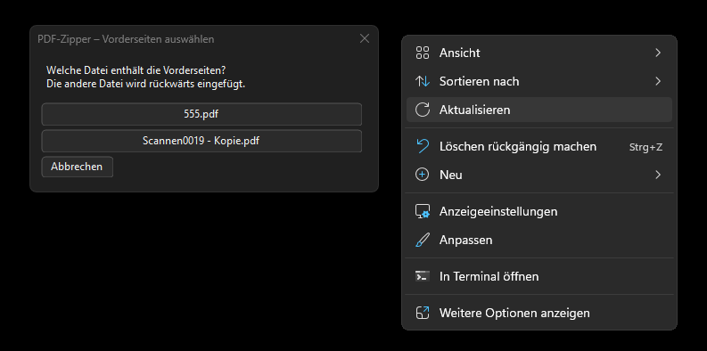
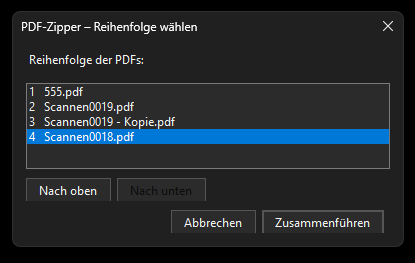
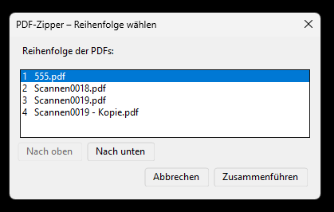
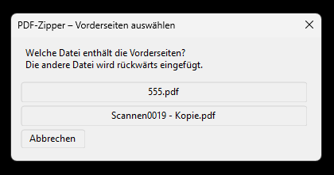
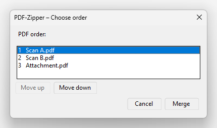
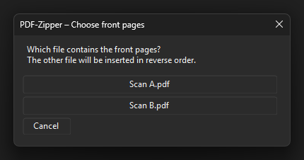

# PDF-Zipper

Zwei Scan-PDFs im Windows-11-Explorer markieren → Rechtsklick → **PDF-Zipper** → **PDFs verzahnen**.

PDF-Zipper kombiniert Vorderseiten in normaler Reihenfolge mit Rückseiten in umgekehrter Reihenfolge. Beispiel:

| Eingabe | Seiten |
| --- | --- |
| Vorderseiten | 1, 3, 5 |
| Rückseiten (Scanreihenfolge) | 6, 4, 2 |
| Ergebnis | 1, 2, 3, 4, 5, 6 |

## Word, PDF und Bilder gemeinsam zusammenführen (0.1.13)

Mindestens zwei Dateien im selben Ordner markieren → **PDF-Zipper → Als PDF zusammenführen**. Unterstützt werden `.pdf`, `.doc`, `.docx`, `.jpg`, `.jpeg` und `.png`. Im kompakten Dialog die Reihenfolge wählen. Word exportiert die Dokumentseiten; Bilder werden proportional auf jeweils eine A4-Seite mit 10 mm Rand gesetzt, einschließlich EXIF-Ausrichtung. Die Ausgabe entsteht im selben Ordner, Originale bleiben unverändert und vorhandene Dateien werden nicht überschrieben.

**Worddateien benötigen die installierte Desktopversion von Microsoft Word.** Ohne Word ist diese Funktion bei einer Auswahl mit Worddateien ausgegraut. PDF und Bilder benötigen kein Word. Eine defekte oder nicht aktivierte Wordinstallation kann den Export verhindern. Worddateien werden schreibgeschützt geöffnet; Dokumentmakros und automatische Linkaktualisierung beim Öffnen werden deaktiviert. Die Darstellung hängt von Word und verfügbaren Schriftarten ab. Während des Auftrags zeigt ein kleines Fenster die aktuelle Datei. Word kann seine eigenen Office-Funktionen ausführen; PDF-Zipper selbst stellt keine Netzwerkverbindungen her.

Bei reiner PDF-Auswahl bleiben die bisherigen Funktionen erhalten. Andere Dateiformate, passwortgeschützte Worddokumente und mehrseitige Bildformate werden nicht unterstützt.

## Screenshots

**Word, PDFs und Bilder gemeinsam als PDF zusammenführen:**



Aktuelles Explorer-Menü und Dialoge unter Windows 11. Die Screenshots zeigen Testdateien und das helle sowie dunkle Windows-Design.





**Vorderseiten auswählen** – bei unklaren Dateinamen genügt ein Klick auf die passende PDF:



**PDFs zusammenführen** – ausgewählte PDFs über „Nach oben“ und „Nach unten“ in die gewünschte Reihenfolge bringen:







**English interface (0.1.12):**





## Bedienung

Beide Dateien müssen im selben Ordner liegen. Gleiche Seitenzahlen sind nur beim Verzahnen erforderlich. Der Eintrag erscheint bei mindestens zwei PDF-Dateien. Bei genau zwei sind beide Funktionen verfügbar; bei mehr als zwei wird nur **PDFs zusammenführen** angeboten. Die Reihenfolge der Explorer-Auswahl spielt keine Rolle.

Eindeutige Wörter im Dateinamen werden erkannt: `Vorderseite`, `Vorderseiten`, `vorne`, `front`, `fronts`, `recto` sowie `Rückseite`, `Rückseiten`, `Rueckseite`, `Rueckseiten`, `hinten`, `back`, `backs`, `verso`. Beide Namen müssen übereinstimmende Hinweise geben. Beispiel: `Scan_Vorderseiten.pdf` und `Scan_Rückseiten.pdf`.

Bei unklaren oder widersprüchlichen Namen öffnet sich eine kleine Auswahl: einmal auf die Datei mit den Vorderseiten klicken. Mit Escape oder „Abbrechen“ wird nichts geschrieben.

Auch fortlaufende Scan-Nummern werden erkannt: `en0018.pdf` und `en0019.pdf` oder `18.pdf` und `19.pdf`. Die kleinere Nummer gilt als Vorderseite (zuerst gescannte Datei). Das gilt nur für direkt aufeinanderfolgende Nummern mit identischem Text davor und danach und genau einem Zahlenblock pro Name. Eindeutige Vorder-/Rückseiten-Wörter haben Vorrang; bei widersprüchlichen Angaben bleibt die Auswahl erhalten.

Das Ergebnis liegt im selben Ordner: `<Vorderseitenname>_verzahnt.pdf`. Existiert dieser Name bereits, folgen ` (1)`, ` (2)` usw. Vorhandene Dateien und Originale werden niemals überschrieben. Erst die fertig geschriebene PDF wird unter ihrem endgültigen Namen sichtbar. Erfolgreiche Aufrufe enden ohne weiteren Dialog.

Die Verarbeitung wird im Explorer gestartet. Der Startmenüeintrag zeigt eine kurze Bedienhilfe. Kein Autostart, kein eigener Hintergrunddienst, keine Netzwerkanfragen oder Telemetrie. Die Explorer-Erweiterung übergibt nur die Auswahl; die PDF-Verarbeitung läuft in einem eigenen Prozess.

## PDFs zusammenführen

Rechtsklick → **PDF-Zipper** → **PDFs zusammenführen** öffnet einen kompakten Dialog im hellen oder dunklen Windows-Design mit einer nummerierten Liste aller ausgewählten Dateien. Datei markieren und mit **Nach oben** oder **Nach unten** umsortieren; **Zusammenführen** bestätigt, Escape oder **Abbrechen** schreibt nichts. Zuerst werden alle Seiten der ersten Datei, danach alle Seiten der weiteren Dateien in ihrer ursprünglichen Reihenfolge übernommen. Unterschiedliche Seitenzahlen sind erlaubt.

Ausgabe: `<ErsteDatei>_zusammengeführt.pdf` im selben Ordner, bei Namenskollision mit fortlaufendem Zusatz. Originale und vorhandene Dateien bleiben erhalten.

Alle Dialoge verwenden die Windows-Einstellung für Hell/Dunkel, einschließlich der Titelleiste. Bei aktiviertem Kontrastdesign haben die Windows-Systemfarben Vorrang. Die Fenster sind kompakt und skalieren mit der Bildschirm-DPI.

## Installation und Status

Ziel: Windows 11, x64. Der Eintrag soll direkt im neuen Kontextmenü erscheinen. Dafür wird die von Microsoft vorgesehene Kombination aus `IExplorerCommand` und MSIX-Registrierung verwendet. [Microsoft-Dokumentation](https://learn.microsoft.com/en-us/windows/apps/desktop/modernize/desktop-to-uwp-extensions#specify-a-context-menu-handler-for-a-file-type).

**Aktueller Stand: 0.1.13.** Der lokale Build mit nativen COM-Auswahltests und Word-Konvertierung wurde auf dem Entwicklungs-PC durchgeführt und vom Nutzer ausprobiert. 198 PDF-/Bildprüfungen bestanden; der lokale Build prüft zusätzlich einen echten Wordexport und das ausgegraute Menü bei fehlendem Word. Version 0.1.12 ist bereits im Microsoft Store verfügbar. Das Store-Update für 0.1.13 wird zur Prüfung vorbereitet; Veröffentlichung manuell. Ein Test auf einem frisch eingerichteten zweiten PC steht noch aus.

Der GitHub-Installer für 0.1.13 enthält das signierte MSIX und ein **internes Testzertifikat**. Auf einem neuen PC ist eine ausdrückliche Vertrauenseinrichtung erforderlich. Das Store-Paket ist für die Store-Einreichung bestimmt. [Installationsanleitung](installer/INSTALLATION.md) · [Releases und Installer](https://github.com/kulmi84/PDF-Zipper/releases).

Installer-ZIP vollständig entpacken und `Install-PDF-Zipper.cmd` doppelklicken. Bei erstmaliger Einrichtung das Zertifikatsvertrauen mit `JA` und anschließend per Windows-Administratorabfrage bestätigen. Danach läuft PDF-Zipper ohne Build-Werkzeuge und ohne installiertes .NET. Updates verwenden denselben Installer; Deinstallation über Windows-Einstellungen entfernt die Menüregistrierung. Ergebnis-PDFs bleiben erhalten.

## Grenzen

- Beim Verzahnen unterschiedliche Seitenzahlen: Abbruch statt stiller Ergänzung oder Verwerfung. Eine fehlende letzte Rückseite muss vorab ergänzt werden.
- Verschlüsselte/passwortgeschützte und beschädigte PDFs werden abgewiesen.
- Für Scans gedacht: Dokument-Lesezeichen, digitale Signaturen, PDF/A-Konformität und dokumentweite Formularlogik werden nicht garantiert erhalten. Originale aufbewahren.
- Keine automatische Erkennung anhand des Seiteninhalts, keine Drehung, keine OCR und keine Dateikomprimierung.
- Beim Verzahnen wird die Rückseiten-PDF immer umgekehrt. Bereits richtig geordnete Rückseiten vorher umsortieren.

## Entwicklung und Build

Benötigt: .NET 8 SDK, Visual Studio 2022 Build Tools mit „Desktopentwicklung mit C++“, CMake und Windows SDK.

```powershell
dotnet run --project tests/PdfZipper.Tests.csproj -c Release
./scripts/build.ps1
```

Der Build erstellt eine eigenständig lauffähige x64-Anwendung, eine native Shell-DLL mit statischer C++-Laufzeit und ein **unsigniertes** MSIX unter `artifacts/`. Ein installiertes .NET ist auf dem Zielgerät nicht erforderlich. Für erneute Paket-Builds einen frischen Checkout verwenden oder den vorhandenen Build-Ordner entfernen.

Für ein bereits eingerichtetes Code-Signing-Zertifikat im Zertifikatsspeicher des aktuellen Benutzers:

```powershell
# Beim Build -Publisher mit dem exakten Zertifikats-Subject angeben.
./scripts/sign.ps1 -Package ./artifacts/PDF-Zipper-0.1.13.0-x64.msix -CertificateThumbprint '<Thumbprint>'
```

Ein RFC-3161-Zeitstempeldienst kann mit `-TimestampUrl` angegeben werden. Das Skript signiert und prüft die Signatur; es erzeugt keine Zertifikate und richtet kein Vertrauen ein.

GitHub Actions führt dieselben Tests und die Paketvalidierung durch. Es veröffentlicht keine Releases automatisch. Zum direkten Entwicklertest:

```powershell
& ./src/PdfZipper/bin/Release/net8.0-windows/PDF-Zipper.exe 'C:\Scans\Vorderseiten.pdf' 'C:\Scans\Rückseiten.pdf'
```

Die Tests prüfen Seitenreihenfolge anhand unterschiedlicher Seitengrößen, Erkennung, unveränderte Originale, Namenskollisionen einschließlich paralleler Aufrufe und Fehlerfälle.

## Lizenz

MIT, Copyright 2026 kulmi84. Bibliotheken und Laufzeit: siehe [THIRD-PARTY-NOTICES.md](THIRD-PARTY-NOTICES.md).


## Sprache / Language

PDF-Zipper verwendet Deutsch bei deutscher Windows-Anzeigesprache und sonst Englisch. Explorer-Menü, Dialoge, Bedienhilfe, Fehlermeldungen und Ergebnisdateinamen folgen dieser Auswahl. Die Dateinamen-Erkennung unterstützt deutsche und englische Begriffe unabhängig von der Anzeigesprache. Original-Dateinamen werden nicht verändert.

PDF-Zipper uses German when the Windows display language is German, and English otherwise. Explorer actions, dialogs, usage instructions, error messages and output filename suffixes follow this selection. Filename detection supports German and English terms in either language. Original filenames remain unchanged.

